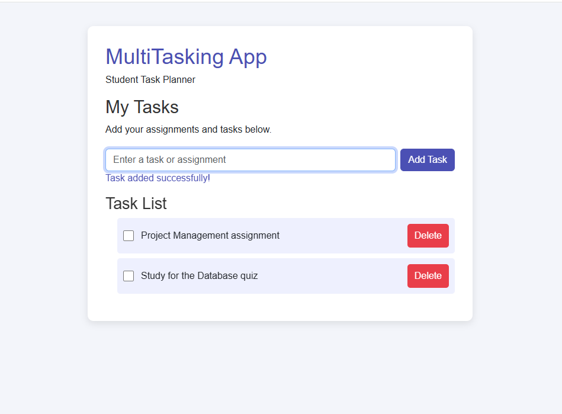
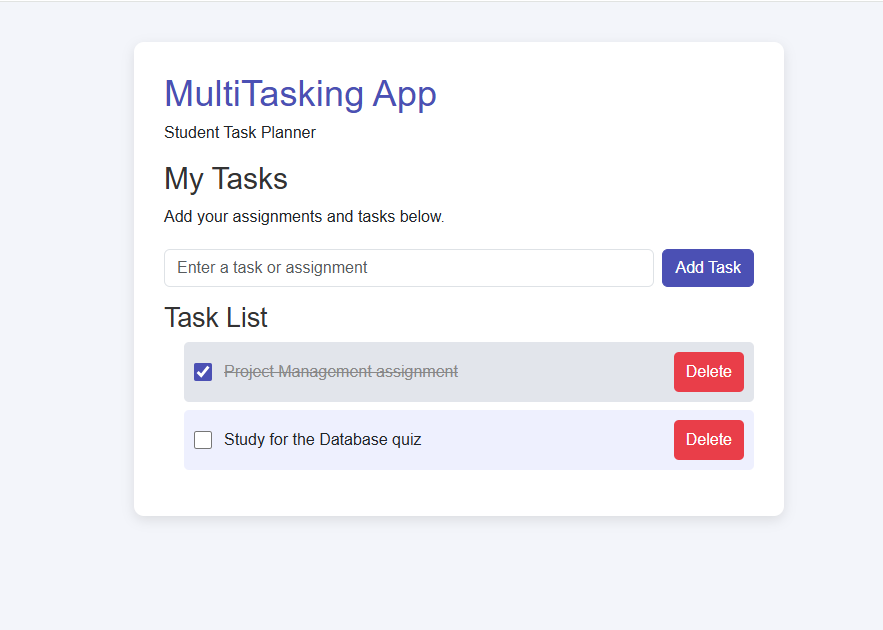

# MultiTasking App
Student Task Planner built using AI assisted development 

## Description
The MultiTasking App is a student task planner that helps students organize their assignments and schoolwork. Students can add tasks mark them as completed, and delete tasks they no longer need also the application also saves tasks in the browser so they do not
disappear when the page is refreshed

## Purpose
I decided to create this application because students have
different assignments and responsibilities to keep track of and I wanted to build a simple application that could help students organize their tasks and see what they still need to complete

## Features
- Add new tasks to a list
- Prevent empty tasks from being added
- Delete tasks that are no longer needed
- Mark tasks as completed using a checkbox
- Unmark completed tasks
- Save tasks automatically using localStorage
- Keep tasks and their completion status after refreshing

## Technologies Used
- HTML - Structure of the application
- CSS - Styling and layout
- JavaScript - Application functionality
- Bootstrap 5 - CSS framework for styling and responsive design
- localStorage - Saving tasks in the browser
- Visual Studio Code - Code editor
- Git and GitHub - Version control and publishing

## AI Tools Used
I used ChatGPT as an AI assistant during the development of my application it has helped with generating the initial code,
implementing features, explaining JavaScript functionality, and suggesting improvements I reviewed the changes and tested the application to make sure the features worked correctly

## Installation
1. Download or clone the GitHub repository
2. Open the project folder
3. Make sure index.html, style.css, and script.js are in the same folder
4. No additional software or packages are required
5. An internet connection is needed to load Bootstrap from the CDN

## Running the Application
1. Open the project folder
2. Double-click index.html
3. The application will open in your web browser
4. Start adding and managing tasks

## Future Improvements
- Add due dates for assignments
- Allow students to set priorities for their tasks
- Add an Edit button to update existing tasks

## How AI Was Used
During the development of MultiTasking App, I used ChatGPT to assist with creating features, improving the code  I have reviewed and tested the application after making changes to make sure everything worked correctly 

### Prompt 1 - Initial Application
Create the first version of my Student Task Planner web application called MultiTasking App using HTML, CSS, and JavaScript. I want students to be able to enter an assignment or task name, click an Add Task button, and see the task added to a list. Keep the design simple for now and separate the code into index.html, style.css, and script.js

### Prompt 2 - Completing Tasks
I want to add a feature to my MultiTasking App that allows students to mark tasks as completed. When a task is completed, the text should have a line through it not only that, students should also be able to unmark a completed task keeping the existing Add
Task and Delete Task functionality working

### Prompt 3 - Saving Tasks
I want to improve my MultiTasking App by saving tasks using JavaScript localStorage currently, tasks disappear when I refresh the page i want added tasks and their completion status to be saved automatically, and deleted tasks should stay deleted keep my existing Add Task, Delete Task, and checkbox functionality working

## Screenshots
### Task List
This screenshot shows the MultiTasking App with tasks added to the list so students can add, complete, and delete tasks

### Completed Task
This screenshot shows a task marked as completed with a line through its text. The completion status is saved when the page is refreshed.

## Vibe Coding Reflection

### 1. What did AI do particularly well?
ChatGPT helped me create the initial structure of my application and understand how the different parts of the code work together not only that, it was also useful when adding features such as deleting tasks, marking tasks as completed, and saving tasks using localStorage

### 2. What did AI do poorly?
One limitation of the initial application was that tasks disappeared whenever I refreshed the page so I had to improve this by adding localStorage not only that AI also suggested some features and design changes that were more complicated than what I needed, so I had to decide which improvements were useful for my application

### 3. How did you verify AI-generated code?
I tested my application in the browser after making changes and I checked that I could add tasks, delete them, and mark them as completed or incomplete so I also refreshed the page to make sure the tasks and their completion status were saved, At first, the CSS was not displaying correctly, so I checked the files and refreshed the browser until the styling worked

### 4. How did your prompts evolve?
At the beginning, my prompt was more general because I wanted to create a basic student task planner but as I continued developing the application, my prompts became more specific for example, when adding localStorage, I explained that the tasks disappeared after refreshing and that I wanted the completion status to be saved without affecting the other features

### 5. What did you learn?
I learned more about how HTML, CSS, and JavaScript work together to create an interactive application not only that I also learned how localStorage can save information in the browser and why it is important to test the application after making changes so this assignment helped me understand how AI can assist with software development

### 6. Would you trust AI to build the entire application without human supervision?
No, I would not completely trust AI to build an application without human supervision because the generated code might contain errors or might not work exactly as expected for me I think AI is useful for assisting with development, but the developer still needs to understand the code, test the functionality, and make sure everything works correctly